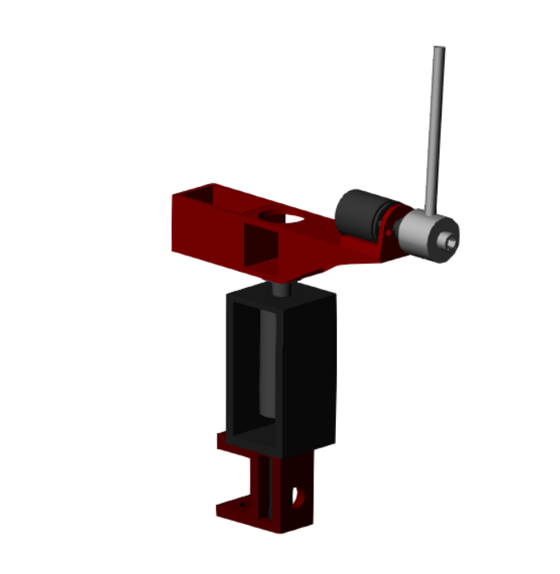
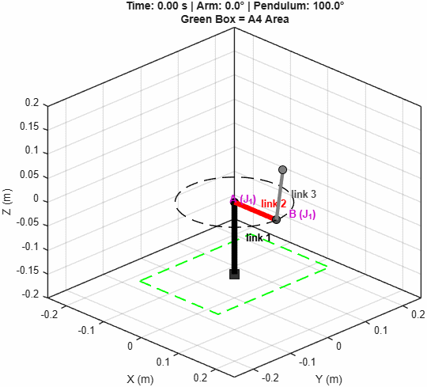
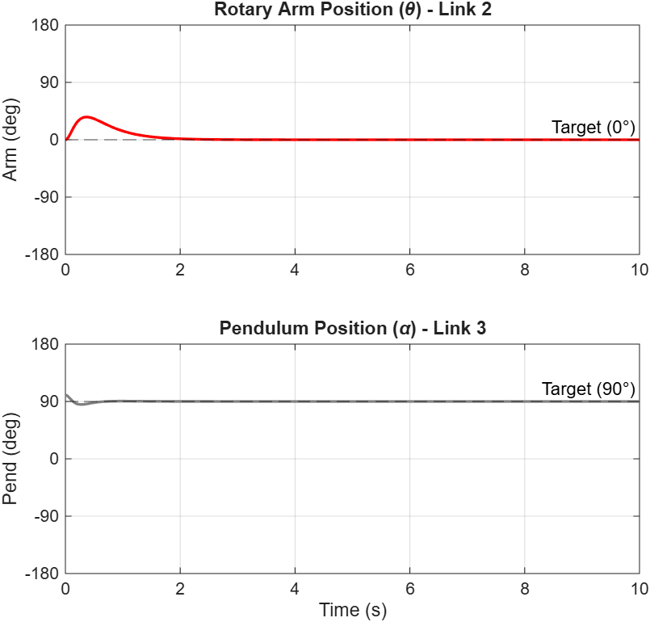
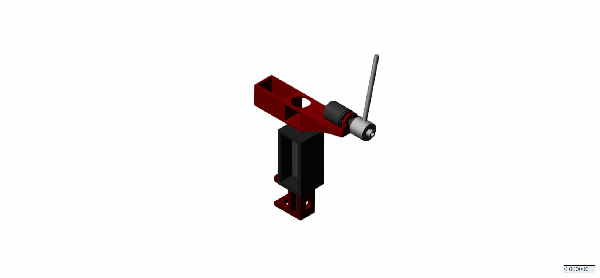
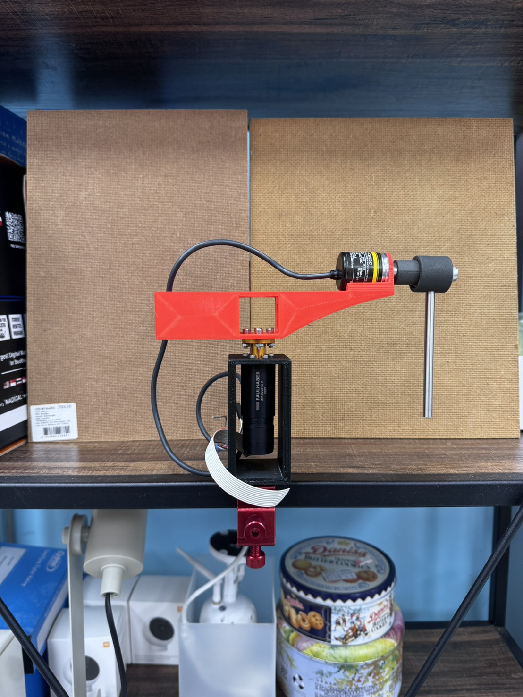
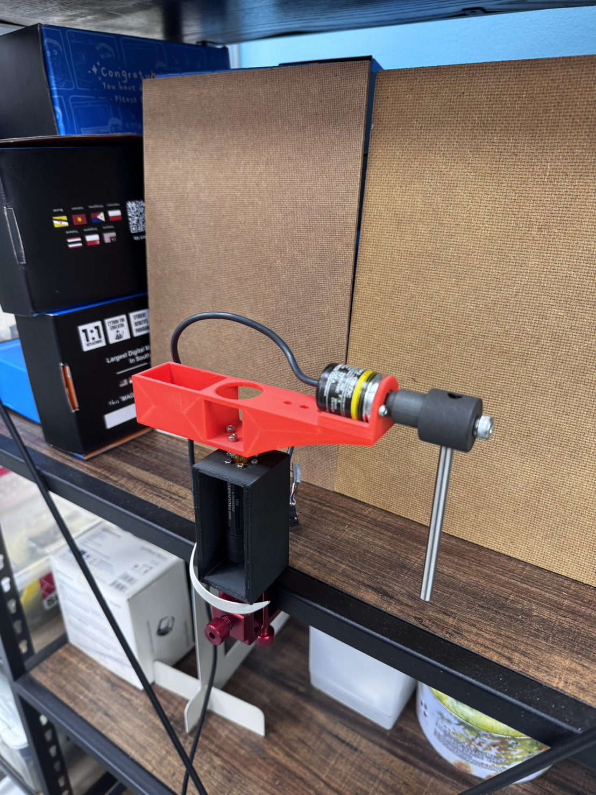

# Rotary Inverted Pendulum — Design, Dynamics & Simulation

Mechanical machinery project exploring a **Furuta pendulum** through CAD design, nonlinear MATLAB simulation, feedback control, Simscape Multibody modeling, and a physical prototype.

<p align="center">
  
</p>

## Project Overview

A motor rotates a horizontal arm about a vertical axis. A pendulum attached at the arm tip swings about a second revolute joint. The motor acts on the arm; the pendulum is controlled indirectly through the coupled dynamics. The upright position is unstable, making this **two-degree-of-freedom, single-input system** a platform for studying underactuated motion and feedback control.

| Item | Description |
|---|---|
| Author | Deegit Chayawan (6730179521) <br> Songprod Raksaphakdee (6730190321) <br> Pongkun Sukonrat (6730301721) |
| Semester | 1/2026 |
| Mechanism | Spatial rotary inverted pendulum / Furuta pendulum |
| Modeling | Nonlinear equations of motion and linearized state-space models |
| Control in MATLAB script | Blended energy-based swing-up and LQR balancing |
| Control design in parameter script | State feedback, observer design, LQR and Kalman filtering |
| Tools | Fusion 360, MATLAB, Simulink, Simscape Multibody |

### Repository Guide

| Path | Contents |
|---|---|
| [`hardware/mechanical/`](hardware/mechanical/) | STEP files for links and mounting clamp |
| [`hardware/electronics/`](hardware/electronics/) | STEP geometry for motor body and encoder |
| [`hardware/`](hardware/) | Prototype photographs and a BOM template |
| [`simulation/Rotary_inverted_pendulum_symbolic.m`](simulation/Rotary_inverted_pendulum_symbolic.m) | Nonlinear numerical simulation, LQR design, state plots and 3D animation |
| [`simulation/Rotary_inverted_pendulum_params.m`](simulation/Rotary_inverted_pendulum_params.m) | Motor, geometry and controller parameters for the Simscape workflow |
| [`simulation/Rotary_inverted_pendulum_control_.mat`](simulation/Rotary_inverted_pendulum_control_.mat) | Stored state-space matrices loaded by the parameter script |
| [`simulation/Rotary_inverted_pendulum_simscape_model.slx`](simulation/Rotary_inverted_pendulum_simscape_model.slx) | Simulink / Simscape model |
| [`simulation/Rotary_inverted_pendulum_simscape_model.avi`](simulation/Rotary_inverted_pendulum_simscape_model.avi) | Project video; download to play |

## Part I: Mechanism, Coordinates & Working Space

### Links and Joints

| Element | Function |
|---|---|
| Fixed base | Supports the motor and provides the ground reference |
| Rotary arm | Motor-driven link rotating in the horizontal plane |
| Pendulum | Passive link swinging about the joint at the arm tip |
| Joint A | Actuated revolute joint between the base and arm |
| Joint B | Passive revolute joint between the arm and pendulum |

The idealized mechanism has **3 links including ground and 2 independent revolute joints**, giving **2 DOF**. One motor provides the input, so the system is underactuated. This is a spatial mechanism; its mobility follows from the two independent joint coordinates.

### Angle Conventions

The existing simulation workflows use different pendulum angle references:

| Quantity | Nonlinear MATLAB script | Simscape parameter script |
|---|---|---|
| Hanging down | `alpha = -90°` | `alpha = 0°` after calibration |
| Horizontal | `alpha = 0°` | `alpha = 90°` after calibration |
| Upright | `alpha = 90°` | `alpha = 180°` after calibration |
| Initial pendulum angle | `100°` | `alpha_0 = 170°` |

For these positive-angle conventions, the calibrated Simscape angle corresponds to the MATLAB angle plus 90°. Confirm sensor polarity and CAD-frame calibration before comparing signals.

The nonlinear script uses the upright angle error:

$$
\beta = \alpha - \frac{\pi}{2}
$$

The error is wrapped to the interval $[-\pi,\pi)$ for feedback. Angles are in radians internally in the nonlinear simulation.

### Nominal Geometry

Both scripts specify a rotary arm length of **112.19 mm**, a pendulum length of **100 mm**, and a pendulum mass of **0.1 kg**. The nonlinear model places the pendulum center of mass **50 mm** from its joint.

The pendulum tip coordinates used by the MATLAB animation are:

$$
\begin{aligned}
x_p &= L_r\cos\theta + L_p\cos\alpha\sin\theta,\\
y_p &= L_r\sin\theta - L_p\cos\alpha\cos\theta,\\
z_p &= L_p\sin\alpha.
\end{aligned}
$$

The animation draws an A4 reference rectangle on the floor. This is a visual reference rather than a verified motion envelope: full arm rotation alone sweeps a diameter of 224.38 mm, exceeding the 210 mm short side of A4.

## Part II: Mathematical Model & MATLAB Simulation

The file is named [`Rotary_inverted_pendulum_symbolic.m`](simulation/Rotary_inverted_pendulum_symbolic.m), but its current implementation evaluates explicit nonlinear equations numerically with `ode45`; it does not invoke symbolic derivation commands.

### Equations Implemented in the Script

Define the generalized coordinates as:

$$
q =
\begin{bmatrix}
\theta\\
\beta
\end{bmatrix}.
$$

The script solves:

$$
M(q)\ddot q =
\begin{bmatrix}
\tau_{arm}-C_1\\
-C_2
\end{bmatrix},
$$

with the mass matrix:

$$
M(q)=
\begin{bmatrix}
J_{r,t}+m_p l_p^2\sin^2\beta & m_p L_r l_p\cos\beta\\
m_p L_r l_p\cos\beta & J_{p,t}
\end{bmatrix}.
$$

The effective inertias in the script are:

$$
J_{r,t}=J_r+m_pL_r^2,
\qquad
J_{p,t}=J_p+m_pl_p^2.
$$

The remaining terms are:

$$
\begin{aligned}
C_1 &= m_p l_p^2\sin(2\beta)\dot\theta\dot\beta
-m_pL_rl_p\sin\beta\,\dot\beta^2,\\
C_2 &= -\frac{1}{2}m_pl_p^2\sin(2\beta)\dot\theta^2
-m_pgl_p\sin\beta+b_\alpha\dot\beta,\\
\tau_{arm} &= \gamma V_m-b_{eq}\dot\theta,\\
\gamma &= \frac{NK_t}{R_m},\\
b_{eq} &= b_\theta+\frac{N^2K_tK_m}{R_m}.
\end{aligned}
$$

These equations document the current implementation. The nonlinear script sets the pendulum inertia to:

$$
J_p=\frac{1}{3}m_pL_p^2
$$

and then adds the parallel-axis term to form:

$$
J_{p,t}=J_p+m_pl_p^2.
$$

The parameter script instead uses the pivot inertia directly:

$$
J_p=\frac{1}{3}m_pL_p^2.
$$

Reconcile this inertia convention before quantitative comparisons between the two workflows.

The nonlinear script now uses `J_r = (1/3)*0.15*L_r^2`, giving an arm inertia of approximately **0.00062933 kg·m²**. The Simscape parameter script uses an arm mass of `0.05 + 0.08 = 0.13 kg`, giving approximately **0.00054542 kg·m²**. These are the values in the current source files; the two inertia definitions have not been forced to match.

### Control Strategy

Near upright, the MATLAB simulation uses an LQR controller with the error state:

$$
x_e=
\begin{bmatrix}
\theta\\
\beta\\
\dot\theta\\
\dot\beta
\end{bmatrix}.
$$

The feedback voltage is:

$$
V_{LQR}=-K_{LQR}x_e.
$$

The LQR weights are `Q = diag([100, 600, 20, 20])` and `R = 2`.

Away from upright, an energy-based controller contributes a swing-up command. The voltage commands are blended using:

$$
w=\exp\left[-\left(\frac{\beta}{0.5}\right)^2\right].
$$

A smooth voltage limit is then applied:

$$
V_m=V_{max}\tanh\left(
\frac{wV_{LQR}+(1-w)V_{swing}}{V_{max}}
\right).
$$

The script simulates **10 seconds**, starting with:

- Arm angle: **0°**
- Pendulum angle: **100°**
- Arm angular velocity: **0 rad/s**
- Pendulum angular velocity: **0 rad/s**

It produces arm and pendulum angle histories and an animated 3D view. This initial condition is 10° from upright; it does not by itself demonstrate swing-up from the hanging equilibrium.

### MATLAB Simulation Animation & Response

The following outputs were regenerated from source revision `6acf265` by running `Rotary_inverted_pendulum_symbolic.m` with its existing equations, controller parameters and initial conditions. The animation is sampled at 10 frames per second for display.



The plots show the rotary arm angle and pendulum angle over the 10-second simulation. The pendulum starts at 100° and approaches the 90° upright target; the arm returns toward its 0° reference.



These are numerical simulation outputs, not experimental measurements or a symbolic derivation.

## Part III: Simscape Multibody & Controller Design

### Simulation Animation

The animation below was refreshed from the supplied `Rotary_inverted_pendulum_simscape_model.avi` video in source revision `6acf265` and plays directly on this page.



The [parameter script](simulation/Rotary_inverted_pendulum_params.m) builds a linearized model about upright, loads `A` and `B` from the [MAT file](simulation/Rotary_inverted_pendulum_control_.mat) when available, and otherwise uses its hand-built matrices.

It computes pole-placement feedback and observer gains, followed by LQR and Kalman-filter quantities.

### Parameters Currently Used

| Parameter | Nonlinear MATLAB script | Simscape parameter script |
|---|---:|---:|
| Arm length | 0.11219 m | 11.219 cm, converted to SI for the linear model |
| Pendulum length | 0.10 m | 10 cm, converted to SI for the linear model |
| Pendulum mass | 0.10 kg | 0.10 kg |
| Motor torque constant | 0.035 N·m/A | 0.035 N·m/A |
| Motor back-EMF constant | 0.035 V·s/rad | 0.035 V·s/rad |
| Gear ratio | 1 | 1 |
| Voltage limit | 24 V | 24 V |

The [model](simulation/Rotary_inverted_pendulum_simscape_model.slx) metadata records **MATLAB R2026b**. Its geometry references include absolute paths from the original computer and STEP filenames absent from this repository. See the [simulation guide](simulation/README.md) for setup details.

### Running the Project

Clone the repository, open MATLAB, and set the repository root as the current folder.

```bash
git clone https://github.com/deegitdg/Mech-Machinery-Rotary-Inverted-Pendulum.git
```

For the standalone numerical simulation:

```matlab
run(fullfile('simulation', 'Rotary_inverted_pendulum_symbolic.m'))
```

For the Simscape workflow, initialize parameters and open the model:

```matlab
addpath(fullfile(pwd, 'simulation'))
addpath(fullfile(pwd, 'hardware', 'mechanical'))
addpath(fullfile(pwd, 'hardware', 'electronics'))

run(fullfile('simulation', 'Rotary_inverted_pendulum_params.m'))
open_system('Rotary_inverted_pendulum_simscape_model')
```

Resolve CAD file references and confirm model initialization before starting the Simscape simulation. These are the entry points; successful execution of the uploaded model has not yet been verified in a clean environment.

### Software Requirements

| Workflow | Required software |
|---|---|
| Nonlinear MATLAB simulation | MATLAB and Control System Toolbox |
| Simscape workflow | MATLAB, Control System Toolbox, Simulink, Simscape and Simscape Multibody |
| CAD inspection | Fusion 360 or another STEP-compatible CAD application |

A standalone symbolic derivation is not currently included.

## Part IV: CAD Design & Physical Prototype

<p align="center">
  
  
</p>

The photographs show the assembled arm, pendulum, encoder, motor support and table clamp. The uploaded CAD consists of exchange-format STEP files:

| CAD files | Location |
|---|---|
| `Link1.STEP`, `Link2.STEP`, `Link3.STEP`, `Ground-camp.STEP` | [`hardware/mechanical/`](hardware/mechanical/) |
| `Motorbody.STEP`, `Encodoer.STEP` | [`hardware/electronics/`](hardware/electronics/) |

The native Fusion 360 design, fabrication drawings and a populated component BOM are not currently included. Component specifications and manufacturing dimensions should be taken from the design files and measured hardware.

## Results & Validation Status

The repository provides CAD geometry, prototype photographs, simulation source files, a model image and an AVI video.

The Simscape animation is displayed above. The [original AVI video](simulation/Rotary_inverted_pendulum_simscape_model.avi) is also available for download.

Performance metrics such as settling time, RMS angle error and experimental tracking error are not yet documented with exported time-series data.

A reproducible MATLAB-versus-Simscape comparison requires consistent:

- Inertia definitions
- Motor parameters
- Initial conditions
- Angle references
- Input and controller settings

No numerical agreement or hardware balancing performance is claimed here without those results.
